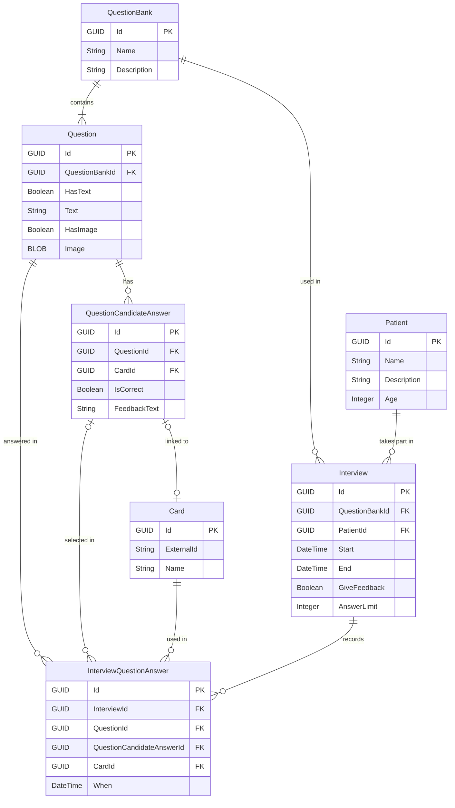

# What

This software is an aid to psychologist when performing evaluation interviews, its main workflow allows to present a list of questions to the screen and the pacient to answer them.

### Entitites

| Entity                  | Purpose                                                                                                  |
| ----------------------- | -------------------------------------------------------------------------------------------------------- |
| QuestionBank            | Set of questions used in interviews.                                                                     |
| Question                | Question (text and/or image) belonging to one bank.                                                      |
| QuestionCandidateAnswer | Possible answer to a question; optionally linked to a Card.                                              |
| Card                    | Physical card. `ExternalId` = decoded QR content.                                                        |
| Patient                 | Patient data only.                                                                                       |
| Interview               | Session for one patient using one bank.                                                                  |
| InterviewQuestionAnswer | Answer history: question, selected answer, card used, timestamp. Independent of bank/card configuration. |

### The interview flow

0. Prepare question Bank, Question, QuestionCandidateAnswer and Card  records
1. Create an Interview (Assign Patient and a QuestionBank).
2. Present question i to the patient
3. Patient inserts card and answer is saved 
4. Repeat from step 2 until all questions are answered or the interview is stoped
5. Present results

### 

# How

## Database schema

### ER Diagram

### Indexes

| Table                   | Field                   | Purpose                                  |
| ----------------------- | ----------------------- | ---------------------------------------- |
| Card                    | ExternalId (**unique**) | Identify the inserted card.              |
| Question                | QuestionBankId          | Questions of a bank.                     |
| QuestionCandidateAnswer | QuestionId              | Answers of a question.                   |
| QuestionCandidateAnswer | CardId                  | Answer matching a card.                  |
| Interview               | QuestionBankId          | Bank used by an interview.               |
| Interview               | PatientId               | Interviews of a patient.                 |
| InterviewQuestionAnswer | InterviewId             | All answers of an interview (most used). |
| InterviewQuestionAnswer | QuestionId              | Answer for a question.                   |
| InterviewQuestionAnswer | CardId                  | Card used in an answer.                  |

