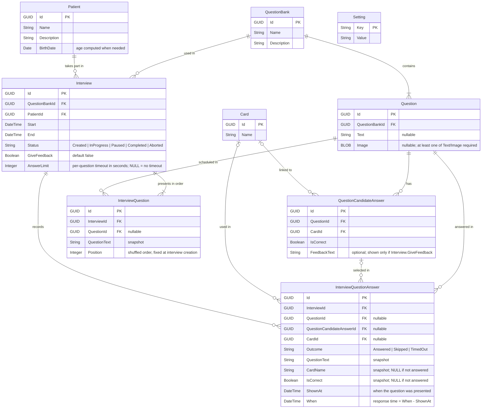

# What

This software is an aid to psychologists when performing evaluation interviews, its main workflow presents a list of questions on the screen for the patient to answer.

### Entities

| Entity                  | Purpose                                                                                                  |
| ----------------------- | -------------------------------------------------------------------------------------------------------- |
| QuestionBank            | Set of questions used in interviews.                                                                     |
| Question                | Question (text and/or image) belonging to one bank.                                                      |
| QuestionCandidateAnswer | Possible answer to a question; optionally linked to a Card.                                              |
| Card                    | Physical card. Its QR encodes `CARD1:<Card.Id>`.                                                         |
| Patient                 | Patient data only.                                                                                       |
| Interview               | Session for one patient using one bank.                                                                  |
| InterviewQuestionAnswer | Answer history: question, selected answer, card used, timestamp. Independent of bank/card configuration. |

### The interview flow

0. Prepare question Bank, Question, QuestionCandidateAnswer and Card records
1. Create an Interview (Assign Patient and a QuestionBank).
2. Present question i to the patient
3. Patient inserts card and answer is saved 
4. Repeat from step 2 until all questions are answered or the interview is stopped
5. Present results

Notes: 

Both the psychologist and the patient will see the same screen, a laptop screen. The next question will be presented if either the psychologist skips the question by clicking a button on the screen or the patient answers by scanning the qr in one of the answer cards.

Psychologist controls are small, discreet buttons at the bottom of the interview screen, also available as keyboard shortcuts: `Space` = skip, `Esc` = pause/stop.

When the timeout expires, the question is recorded as `TimedOut` and the next one is presented. After the last question, an "Interview completed" screen is shown with an "Export CSV" button.

The questions are shown in a random order. This may change in the future but for now that is good enough. The order is generated once when the interview is created and stored in `InterviewQuestion`; resuming continues at the first position without an answer.

There are no "wrong answers", that means an answer is registered whether or not it is correct. The intent of this tool is to evaluate, not to teach.

There is a timeout per question, which can be configured in the interview settings (`Interview.AnswerLimit`).

Feedback is off by default. Only when the interview explicitly enables it (`Interview.GiveFeedback`), the selected answer's `FeedbackText` (if any) is shown after answering, and stays until the psychologist clicks to continue.

Interviews can be stopped and resumed.

### The answer cards and reader

Cards are general purpose answers, mainly emotions, so a simple set of cards (for example happy, sad, angry) could serve as the possible answer set for multiple questions. A question may have one or several expected answers (`IsCorrect`), still we are interested in recording what card was used to answer and whether or not it was the "expected" one.

For the first version, the card reader uses the webcam to scan the QR code in the card. If no camera is available, an error is shown and the interview cannot start; other scanning methods may be added in a future revision. When several cameras exist, the one to use is selected in the app settings (default: first camera). The interview screen shows a small live camera preview so the patient can aim the card. New cards are registered with an autogenerated GUID (`Card.Id`). The QR content is `CARD1:<Card.Id>` (`CARD1` = format prefix and version). On scan: if the prefix doesn't match, or the id is not a candidate answer of the current question, the scan is ignored; otherwise it is registered as the answer. No encryption/signature: a copied card is accepted as the original.

After an answer is registered, scans are ignored until no QR has been detected for ~1 second (the card was removed), to avoid one card answering several questions.

Ignored scans (unknown prefix, unknown card, or card not linked to the current question) are not stored.

The card screen has an "Export QR" action that saves a PNG with the QR and the card `Name` below it, ready to print.

### The results

For this first version, results are returned in a *.csv file, one file per interview.

- Encoding UTF-8 with BOM, comma delimiter, header row.
- One row per `InterviewQuestion`, in presented order (`Position`). Questions not reached (stopped interview) have an empty `Outcome`.
- Interview-level fields are repeated on every row so the file is self-contained.

| Column          | Source                                          |
| --------------- | ----------------------------------------------- |
| PatientName     | Patient.Name                                    |
| PatientAge      | computed from Patient.BirthDate at Interview.Start |
| BankName        | QuestionBank.Name                               |
| InterviewStart  | Interview.Start                                 |
| Position        | InterviewQuestion.Position                      |
| QuestionText    | InterviewQuestion.QuestionText (snapshot; filled even if not reached) |
| Outcome         | Answered / Skipped / TimedOut                   |
| CardName        | InterviewQuestionAnswer.CardName (snapshot)     |
| IsCorrect       | InterviewQuestionAnswer.IsCorrect (snapshot)    |
| ShownAt         | InterviewQuestionAnswer.ShownAt                 |
| AnsweredAt      | InterviewQuestionAnswer.When                    |
| ResponseSeconds | When - ShownAt                                  |

### Other must know

- This app should be a desktop app (Windows), distributed as a portable `.exe` built with PyInstaller. `db.sqlite` lives next to the `.exe`.
- v1 screens: management (create/edit) of Question Banks with their Questions and Candidate Answers, Cards (with "Export QR"), Patients; an Interviews list to create, resume and export CSV; Settings; and the Interview screen.
- Question images: PNG or JPG, max ~5 MB, stored as BLOB, scaled to fit the question area keeping aspect ratio.
- Privacy: v1 has no login and no database encryption. Protecting the machine and its OS account is the user's responsibility.

# How

## Database schema

### ER Diagram

### Indexes

| Table                   | Field                   | Purpose                                  |
| ----------------------- | ----------------------- | ---------------------------------------- |
| Question                | QuestionBankId          | Questions of a bank.                     |
| QuestionCandidateAnswer | QuestionId              | Answers of a question.                   |
| QuestionCandidateAnswer | CardId                  | Answer matching a card.                  |
| QuestionCandidateAnswer | QuestionId, CardId (**unique**) | A card maps to at most one answer per question. |
| Interview               | QuestionBankId          | Bank used by an interview.               |
| Interview               | PatientId               | Interviews of a patient.                 |
| InterviewQuestion       | InterviewId, Position (**unique**) | Question order of an interview.  |
| InterviewQuestionAnswer | InterviewId             | All answers of an interview (most used). |
| InterviewQuestionAnswer | QuestionId              | Answer for a question.                   |
| InterviewQuestionAnswer | CardId                  | Card used in an answer.                  |

Notes:

GUIDs should be stored in a TEXT field.

`Setting` is a key/value table for app settings (e.g. `CameraIndex`).

Dates and DateTimes are stored as ISO-8601 TEXT in local time, including the UTC offset (e.g. `2026-11-04T10:30:00-06:00`).

`InterviewQuestionAnswer` keeps snapshot columns (`QuestionText`, `CardName`, `IsCorrect`) copied at save time, so results stay valid if the bank or cards are later edited or deleted. Its FKs to Question, QuestionCandidateAnswer and Card use `ON DELETE SET NULL`.

`InterviewQuestion` also keeps a `QuestionText` snapshot copied at interview creation; its FK to Question uses `ON DELETE SET NULL`, so the saved order and the CSV survive question deletion.

## The stack

- use python as the preferred programming language
- use the tkinter library for the UI
- use sqlite as the database
- libraries: `opencv-python` (camera + QR decoding), `Pillow` (images in Tkinter), `qrcode` (QR generation), `pyinstaller` (packaging)

## The architecture

- `active_records/`: one active record class per entity (load/save/delete itself).
- `db.py`: SQLite connection and transaction helper used by the active records (no Unit of Work pattern).
- `ui/`: Tkinter screens.
- `services/`: interview flow, QR scanner (webcam capture runs in a background thread), CSV export, QR image export.
- `schema.sql`: database creation script.
- `main.py`: entry point.
